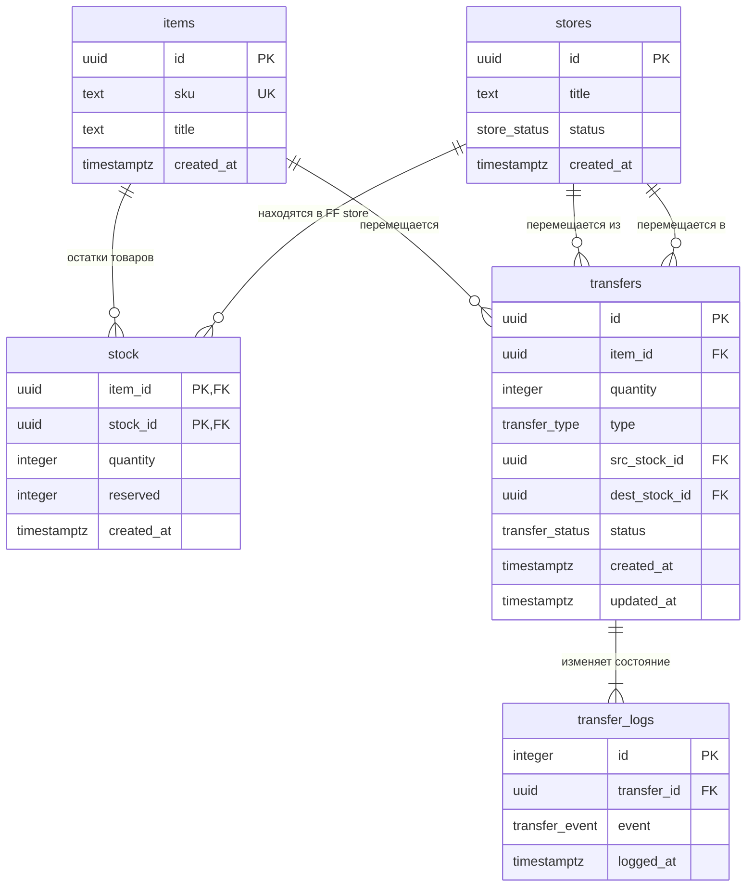

# ER diagram

All tables live in the `stock` schema. Custom enum types:

- `store_status`: `active`, `closed`
- `transfer_type`: `inbound`, `transfer`, `ship_fbo`, `ship_fbs`
- `transfer_status`: `reserved`, `canceled`, `in_transit`, `received`
- `transfer_event`: `inbound`, `shipped`, `received`, `reserved`, `canceled`

